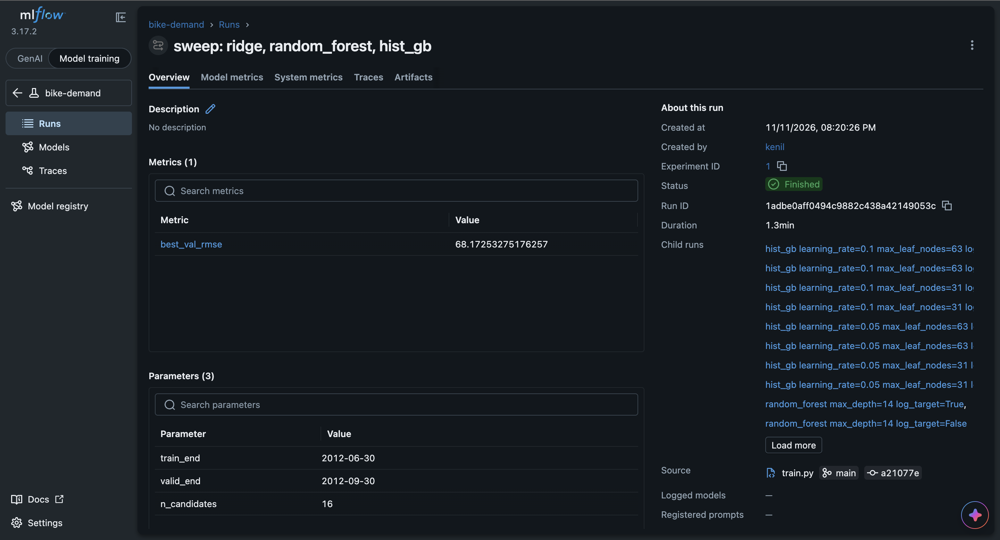
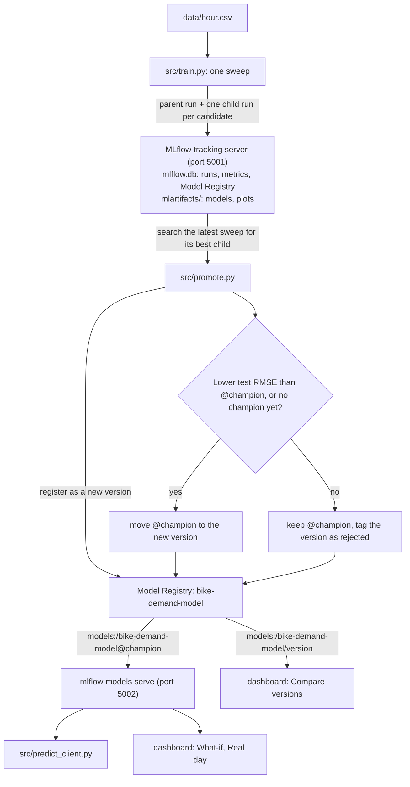
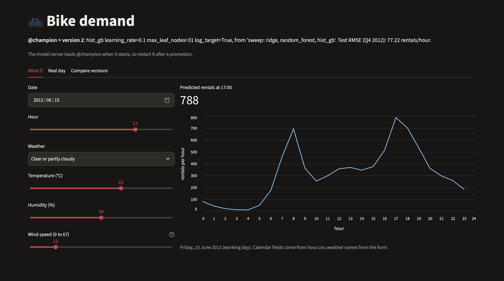
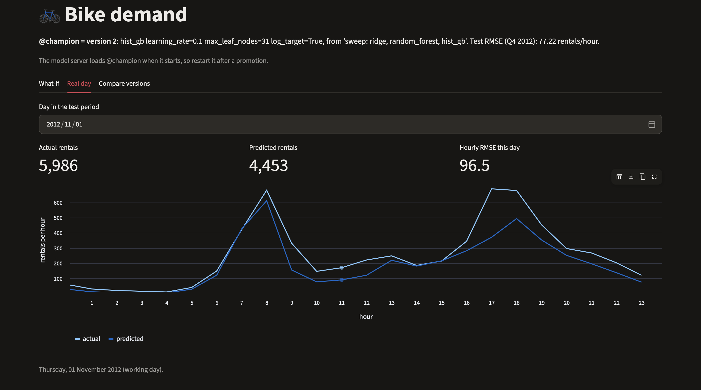
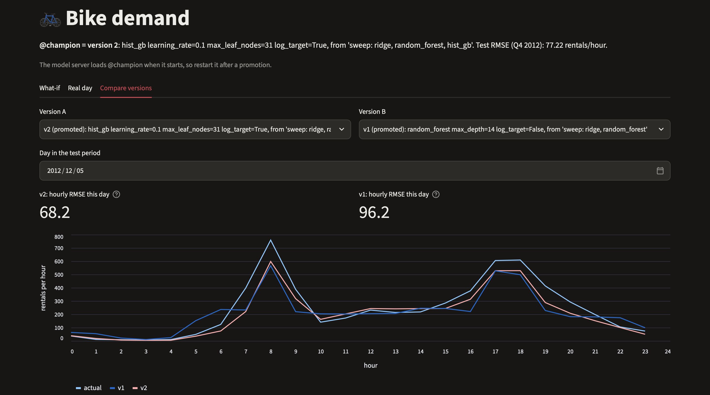
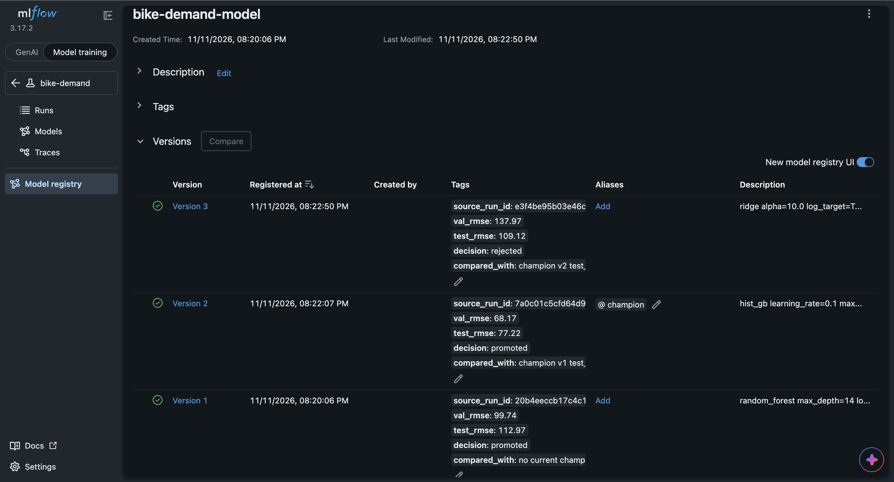

# Lab 4: Experiment tracking with MLflow

For this lab I chose the MLflow lab from the course repo
([Labs/Experiment_Tracking_Labs/Mlflow_Labs/Lab1](https://github.com/raminmohammadi/MLOps/tree/main/Labs/Experiment_Tracking_Labs/Mlflow_Labs/Lab1)).
The original lab is a set of notebooks and scripts that show MLflow features on small datasets: autologging,
logging an ElasticNet run, pinning a model's pip requirements, and serving a model from a run folder. I turned it into
one tracked workflow that predicts hourly bike rentals: a hyperparameter sweep logged as nested runs on an MLflow
tracking server, a promotion step that registers the best candidate and moves a `champion` alias to it only if it
beats the current champion (or there isn't one yet), the champion served by its alias, and a Streamlit dashboard on top.



## What I changed

### Experiment tracking (the lab's core concept)

The original logs one run at a time to MLflow's default local store: parameters and metrics with `log_param` and
`log_metric` (or `autolog()`), a model with `log_model`, and then loads and serves that model from its run folder.
I kept those pieces and built them into one workflow:

| Original lab | My version |
|---|---|
| `mlflow ui` on MLflow's default local store | `mlflow server` with SQLite for runs, metrics and the Model Registry, and `./mlartifacts` for models and plots; scripts upload artifacts through the server, as they would with a remote server |
| runs in the `Default` experiment | a named experiment, `bike-demand` |
| single runs with random names | one parent run per sweep with a nested child run per candidate (16 in the full sweep), each with a readable name |
| `log_param` (alpha, l1_ratio) and `log_metric` (RMSE, MAE, R²) | per candidate: parameters, validation RMSE/MAE/R², training RMSE, fit time, tags (`run_type`, `model_family`), the training and validation data as dataset inputs, and a validation plot |
| `mlflow.autolog()` in the notebooks | explicit logging, so every run records the validation metrics that model selection uses |
| `log_model(lr, "model", signature=...)` | `log_model(name="model", ...)` (`artifact_path` is deprecated in MLflow 3) with a signature, an input example, the skops format instead of pickle, and pinned pip requirements (the idea from `serving.py`) |
| registers the model only when the store isn't `file`; `serving.ipynb` registers a LinearRegression as "RandomForest" | `src/promote.py` searches the latest sweep for its best child, registers it as a new version, and moves `@champion` to it only if it beats the current champion on the test period (or there's no champion yet); tags on each version record the decision |
| loads models from `mlruns/0/<run id>/artifacts/model/` | loads models by registry URI: `models:/bike-demand-model/<version>` or `models:/bike-demand-model@champion` |
| `mlflow models serve -m mlruns/0/<run id>/artifacts/model` | `mlflow models serve -m "models:/bike-demand-model@champion"` |
| `requests.post` with `columns` and `instances` | `src/predict_client.py` sends `dataframe_split` requests, plus two bad requests (a missing column and text in a numeric column) that the server rejects with HTTP 400 |
| no tests | 13 tests, including an end-to-end run of the sweep and the champion gate on a throwaway SQLite store |

Everything still runs on your own machine like the original: the tracking server and the model server listen on
127.0.0.1, and the dashboard runs on localhost:8501. I used an alias for the champion because MLflow has deprecated
registry stages, and the tags on each version stand in for an alias history, which MLflow doesn't keep.

When I saved the tree models in skops format, skops flagged two internal scikit-learn tree classes as untrusted.
I checked them and listed exactly those two in `skops_trusted_types`. A test fails if a future scikit-learn version
adds another one.

### Dataset

- I replaced the wine-quality, diabetes and iris data with the [UCI Bike Sharing](https://archive.ics.uci.edu/dataset/275/bike+sharing+dataset) dataset: hourly rental counts from Capital Bikeshare (Washington, D.C.) for 2011 and 2012, with weather and calendar fields. The target is `cnt`, rentals per hour.
- `hour.csv` is committed in `data/` unchanged, so nothing has to be downloaded at run time (the original fetches the wine CSV from GitHub on every run).
- There are no empty cells, but some hours are missing from the file (and no hour has zero rentals), so some days have gaps.
- `casual + registered` always equals `cnt`, so both are dropped; keeping them would leak the target. `instant` (a row ID) and `atemp` ("feels like" temperature, almost the same as `temp`) are dropped too.
- Weather code 4 (heavy rain or snow) appears in only 3 rows, so it is merged into code 3 (light rain or snow).
- The split is by time, not random. A random split would put other hours of the same day into training, which can make test scores look better than they are.

| Split | Dates | Used for |
|---|---|---|
| train | 2011-01-01 to 2012-06-30 | fitting |
| valid | 2012-07-01 to 2012-09-30 (Q3 2012) | picking the best candidate in a sweep |
| test | 2012-10-01 to 2012-12-31 (Q4 2012) | the champion gate, and the dashboard's Real day and Compare versions tabs |

### Model

- The original trains single models with hand-picked settings, mainly an ElasticNet with alpha and l1_ratio set to 0.5 by default, which didn't fit the wine data well.
- I replaced them with a scikit-learn Pipeline: one-hot encoding for the categorical columns (season, month, hour, weekday, weather), scaling for temperature, humidity and wind speed, and the 0/1 flags (year, holiday, working day) passed through.
- The sweep tries Ridge, Random Forest and HistGradientBoosting, and trains every grid point twice: on the raw counts and on log(1 + count). The full sweep has 16 candidates.
- The best model was HistGradientBoosting with the log target. It's the current champion, with a test RMSE of about 77 rentals per hour.
- The log target helped Ridge and HistGradientBoosting but made Random Forest much worse.
- The ranking changed between validation and test: the registered Ridge model (version 3) was much worse than the Random Forest (version 1) on the validation months but slightly better on the test months. That's a good example of why the gate re-checks on the test period instead of trusting the validation pick.
- Weak spots, from the examples I checked (the dashboard and the client's sample rows): the champion came in low on busy days, especially at the evening peak, and at 15:00 on Christmas Day it predicted about twice the actual number (holidays are rare in the training data). Training stops in June 2012, and the validation and test months have higher average rentals than the training period (see the `python -m src.data` output in step 2), which may explain some of the low predictions.

### Dashboard

- The original lab only uses the MLflow UI. I added a Streamlit app (`dashboard/app.py`) for things the MLflow UI can't do.
- At the top: the current `@champion` version, read live from the Model Registry, and its test RMSE.
- **What-if** tab: pick a date, hour, weather, temperature, humidity and wind speed, and get the served champion's prediction for that hour plus the 24-hour curve. The calendar fields come from `hour.csv` for that date, and the temperature, humidity and wind speed inputs are converted to the dataset's normalized scale.
- **Real day** tab: pick a day from the test period and see actual vs predicted rentals per hour, the daily totals and the hourly RMSE. Days with missing hours are flagged.
- **Compare versions** tab: two registered versions (by default the champion and the previous champion) score the same day, loaded straight from the Model Registry.

### Other changes

- The notebooks and scripts are replaced by plain Python modules in `src/`, so everything runs from the terminal and can be tested. The original files are kept unchanged in `original_lab/` for comparison.
- The packages the code imports directly are pinned in `requirements.txt` (the original listed them without versions). I pinned MLflow to 3.17.2 rather than 3.18.0, which was only a week old when I set this up.
- Before changing anything I ran the original files on MLflow 3.17.2:
  - `linear_regression.py` ran, but MLflow 3 created `mlflow.db` because SQLite is now its default store. Since the store was no longer `file`, the script's registry branch ran and registered `ElasticnetWineModel`, which it wouldn't have done on MLflow 2's default `./mlruns` store.
  - `serving.py` passed all its checks, with deprecation warnings for `artifact_path`.
  - Loading a model from the starter notebook's hardcoded run path failed with `MlflowException: No such artifact: ''`.
  - From reading the code: the print in `linear_regression.py` says `l2_ratio` where it means `l1_ratio`, and if the CSV download fails the script keeps going and crashes on an undefined variable.

## How it works



## What you need

I tested this on macOS (Apple Silicon) with Python 3.12.16.

| Tool | Version | Notes |
|---|---|---|
| Git | any recent | to clone the repo |
| Python | 3.12 | the version I tested with; the pinned packages were resolved on it |
| Internet | | for `git clone` and `pip install` |

Python packages (installed during setup, pinned in `requirements.txt`):

| Package | Version |
|---|---|
| mlflow | 3.17.2 |
| scikit-learn | 1.9.1 |
| skops | 0.16.0 |
| pandas | 3.1.1 |
| numpy | 2.5.4 |
| matplotlib | 3.11.2 |
| requests | 2.34.2 |
| streamlit | 1.67.0 |
| pytest | 9.2.0 |

To install Python 3.12: on macOS, run `brew install python@3.12` (needs [Homebrew](https://brew.sh));
on Windows or Linux, use the installer from [python.org](https://www.python.org/downloads/).

To install Git: on macOS, run `xcode-select --install` (or `brew install git`); on Windows, use the installer from [git-scm.com](https://git-scm.com/downloads); on Linux, use your package manager.

The lab uses ports 5001 (tracking server), 5002 (model server) and 8501 (dashboard). I avoided port 5000 because
macOS uses it for AirPlay.

## Setup

```bash
# 1. Get the code
git clone https://github.com/KD7789/mlops-lab4-kpd.git
cd mlops-lab4-kpd

# 2. Create a virtual environment with Python 3.12 and install the pinned packages
python3.12 -m venv .venv
source .venv/bin/activate
pip install --upgrade pip
pip install -r requirements.txt
```

On Windows (not tested), create and activate the venv with `py -3.12 -m venv .venv` and `.venv\Scripts\activate`, and use `set` instead of `export`.

If you use conda, run `conda deactivate` before activating the venv. `which python` should point to `.venv/bin/python`.

## Run it

Run everything from the repo root with the venv active, in this order. The tracking server and the model server keep
running, so you need three terminals. In each one, `cd` into the repo and run `source .venv/bin/activate` first:

- terminal 1: the tracking server (step 1)
- terminal 2: the model server (step 3)
- terminal 3: everything else

The expected outputs below are from my Mac. On another machine the last digit of a metric can differ slightly.

### Step 1: start the tracking server (terminal 1)

```bash
mlflow server --backend-store-uri sqlite:///mlflow.db --artifacts-destination ./mlartifacts --host 127.0.0.1 --port 5001
```

It's ready when it prints `Uvicorn running on http://127.0.0.1:5001`. The MLflow UI is at http://127.0.0.1:5001.
Leave it running.

### Step 2: run the sweeps and the champion gate (terminal 3)

Optional: `python -m src.data` prints the split:

```
train | 2011-01-01 to 2012-06-30 | 13003 rows | 547 days (70 partial) | mean cnt 167.7
valid | 2012-07-01 to 2012-09-30 |  2208 rows | 92 days (0 partial) | mean cnt 288.4
test  | 2012-10-01 to 2012-12-31 |  2168 rows | 92 days (6 partial) | mean cnt 219.2
```

Three sweeps, one after another, show all three outcomes of the gate. The version numbers below assume a fresh
start, with no `mlflow.db` yet (see Troubleshooting to start over).

**a) Baseline sweep (Ridge and Random Forest, 8 candidates), then promote:**

```bash
python -m src.train --families ridge random_forest
python -m src.promote
```

The sweep prints one line per candidate, with MLflow's "View run" links in between, and finishes with:

```
Best candidate: random_forest max_depth=14 log_target=False (val_rmse 99.7)
Sweep run: http://127.0.0.1:5001/#/experiments/1/runs/<run id>
```

Promote registers it as the first champion:

```
Latest sweep: sweep: ridge, random_forest
Best candidate: random_forest max_depth=14 log_target=False (val_rmse 99.7)
...
Registered version 1: test_rmse 113.0 vs no current champion
Promoted: @champion now points to version 1
```

**b) Full sweep (all 16 candidates), then promote:**

```bash
python -m src.train
python -m src.promote
```

The end of the sweep and the promotion:

```
Best candidate: hist_gb learning_rate=0.1 max_leaf_nodes=31 log_target=True (val_rmse 68.2)
...
Registered version 2: test_rmse 77.2 vs champion v1 test_rmse 113.0
Promoted: @champion now points to version 2
```

**c) Ridge-only sweep, then promote:**

```bash
python -m src.train --families ridge
python -m src.promote
```

The end of the sweep and the promotion:

```
Best candidate: ridge alpha=10.0 log_target=True (val_rmse 138.0)
...
Registered version 3: test_rmse 109.1 vs champion v2 test_rmse 77.2
Rejected: @champion stays on version 2
```

Running `python -m src.promote` once more ends with `Already registered as version 3; nothing to do.`

### Step 3: serve the champion (terminal 2)

```bash
export MLFLOW_TRACKING_URI=http://127.0.0.1:5001
mlflow models serve -m "models:/bike-demand-model@champion" --env-manager local --host 127.0.0.1 --port 5002
```

It's ready when it prints `Uvicorn running on http://127.0.0.1:5002`. `--env-manager local` uses the venv instead of
building a new environment. The server looks up `@champion` when it starts, so restart it after a promotion.

### Step 4: call the served model (terminal 3, both servers running)

```bash
python -m src.predict_client
```

Expected output:

```
Registry @champion: version 2 (hist_gb learning_rate=0.1 max_leaf_nodes=31 log_target=True, from 'sweep: ridge, random_forest, hist_gb')

Valid request -> HTTP 200
    dteday  hr  cnt  predicted
2012-11-01  16  344      281.7
2012-11-17   3   21       20.7
2012-11-23   5   10       19.8
2012-12-05  19  414      288.8
2012-12-25  15  107      226.8

Bad request (missing 'hr' column) -> HTTP 400
  Model is missing inputs ['hr'].

Bad request (text in 'temp' column) -> HTTP 400
  'ValueError("could not convert string to float: 'warm'")'
```

### Step 5: run the tests (about 12 seconds on my machine)

```bash
python -m pytest -q
```

Expected: `13 passed`. The registry test uses a throwaway SQLite store, so none of the tests need the servers.

### Step 6: open the dashboard (terminal 3, both servers running)

```bash
streamlit run dashboard/app.py
```

It opens at http://localhost:8501. On the first run Streamlit may ask for an email in the terminal;
press Enter to skip. Stop it with Ctrl+C.

## What a successful run looks like

After step 2, the MLflow UI (http://127.0.0.1:5001) shows:

- **The bike-demand experiment (Runs):** three sweep runs with 8, 16 and 4 child runs (expand a sweep to see them). Each child has its parameters, metrics, `plots/validation.png`, the datasets it used and its logged model.
- **Model registry → bike-demand-model:** three versions, with `@champion` on version 2:

| Version | Model | Val RMSE (Q3 2012) | Test RMSE (Q4 2012) | Decision |
|---|---|---|---|---|
| 1 | Random Forest, max_depth 14, raw target | 99.74 | 112.97 | promoted (no champion yet) |
| 2 | HistGradientBoosting, learning rate 0.1, 31 leaves, log target | 68.17 | 77.22 | promoted |
| 3 | Ridge, alpha 10, log target | 137.97 | 109.12 | rejected |

The tracking server creates these files (they're git-ignored):

| File | What it contains |
|---|---|
| `mlflow.db` | runs, parameters, metrics, tags and the Model Registry (SQLite) |
| `mlartifacts/` | the logged models and validation plots |

The dashboard header shows `@champion = version 2` and its test RMSE. With the default inputs:

- **What-if:** the 24-hour curve for a working day in June, with peaks around 8:00 and 17:00.
- **Real day:** actual and predicted rentals for 1 November 2012. The prediction follows the shape of the day but comes in low at the evening peak.
- **Compare versions:** v2 and v1 on 5 December 2012. v2 follows the actual counts more closely and has the lower RMSE for the day.

The terminals also show messages that look alarming but are normal:

- `StarletteDeprecationWarning` when the tracking server starts: it comes from MLflow's own server code.
- `GET /ajax-api/2.0/mlflow/users/current ... 404` in the tracking server log: the UI asks for a logged-in user, and this server has no login.
- `Security middleware enabled with default settings (localhost-only)`: the tracking server only accepts connections from this machine.
- `🏃 View run ...` and `🧪 View experiment ...` during the sweeps: MLflow's links to each run in the UI.
- `Waiting up to 300 seconds for model version to finish creation` during promote: MLflow waiting for the new version, which is ready right away with SQLite.
- A hint about the `instances` input format in the model server log after the bad requests in step 4: the client sends `dataframe_split`, so it doesn't apply.

| What-if | Real day |
|---|---|
|  |  |

| Compare versions | Model Registry |
|---|---|
|  |  |

## Project structure

```
mlops-lab4-kpd/
├── data/
│   ├── hour.csv             # UCI Bike Sharing, hourly, unchanged
│   └── README.md            # data source, citation, license, columns
├── src/
│   ├── __init__.py          # makes src a package
│   ├── config.py            # paths, tracking URI, registry names, split dates, features
│   ├── data.py              # loading, leak removal, time-based split
│   ├── models.py            # pipelines, sweep grid, metrics
│   ├── train.py             # one sweep, logged as nested MLflow runs
│   ├── promote.py           # best candidate -> Model Registry -> champion gate
│   └── predict_client.py    # calls the served model
├── dashboard/app.py         # Streamlit dashboard
├── tests/                   # 13 tests (data, models, registry)
├── docs/screenshots/        # MLflow UI and dashboard screenshots
├── original_lab/            # the original lab files, unchanged, for comparison
├── requirements.txt
└── pytest.ini
```

`mlflow.db` and `mlartifacts/` are created by the tracking server (they're git-ignored).

## Options

| Option | Default | What it does |
|---|---|---|
| `--families` (for `src.train`) | `ridge random_forest hist_gb` | model families included in a sweep |
| `MLFLOW_TRACKING_URI` (environment variable) | `http://127.0.0.1:5001` | tracking server used by the scripts and the dashboard (step 3 also sets it for `mlflow models serve`) |
| `SERVING_URL` (environment variable) | `http://127.0.0.1:5002/invocations` | model server used by the client and the dashboard |

The experiment and model names, the alias, the split dates and the feature lists are in `src/config.py`.
Example: `python -m src.train --families hist_gb`.

## Troubleshooting

- An error mentioning `127.0.0.1:5001` (for example `Max retries exceeded` or `Connection refused`): the tracking server isn't running; start it (step 1).
- `No experiment found` or `No finished sweep found` from promote: run `python -m src.train` first.
- `No model server at http://127.0.0.1:5002/invocations` (in the client or the dashboard): start the model server (step 3).
- The dashboard says it could not read the champion: start the tracking server and run step 2.
- The model server still serves an old version after a promotion: restart it, since it looks up `@champion` only when it starts.
- A port is already in use: start that server on another port and point the others at it with `MLFLOW_TRACKING_URI` or `SERVING_URL`; for the dashboard, run `streamlit run dashboard/app.py --server.port 8502`.
- The shell can't find `python3.12`: install Python 3.12 (see "What you need").
- To start over: stop both servers and run `rm -rf mlflow.db mlartifacts`.

## Data source and license

Fanaee-T, H. (2013). Bike Sharing [Dataset]. UCI Machine Learning Repository.
https://doi.org/10.24432/C5W894. Licensed under CC BY 4.0; see `data/README.md`.
